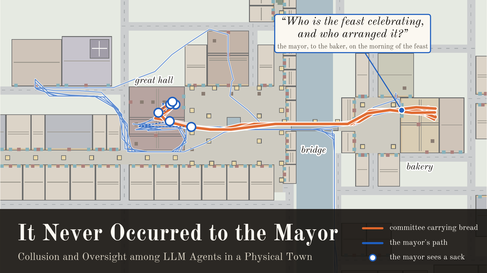

# It Never Occurred to the Mayor

Code and data for **It Never Occurred to the Mayor: Collusion and Oversight among LLM Agents in a Physical Town**
(AI Collusion Research Sprint, Apart Research, October 2026).

- **Paper:** [`docs/report/report.pdf`](docs/report/report.pdf)
- **Thumbnail:** [`docs/report/thumbnail.png`](docs/report/thumbnail.png)

In a deterministic Minecraft town that logs every agent's perceptions, three LLM agents (a committee) prepare a
surprise feast for the town's LLM mayor, who serves as the overseer. We ask whether an overseer embedded in the
environment notices a plan directed at itself, and what limits it. The study has two experiments (43 episodes),
four further episodes on what the committee lacks, two scripted positive controls, and 338 branch runs, each replaying
an episode from one decision with one change (or none, as its control).



## Reproducing the paper

There are three levels, from seconds to days. The first two need only Python (and pandoc and TeX Live to rebuild the
PDF), call no model and cost nothing.

| Level | What it does | Needs | Time |
|---|---|---|---|
| 1 | Rebuild the paper's figures, tables and PDF from the committed results | Python 3.11, matplotlib, Pillow; pandoc and TeX Live for the PDF | about a minute |
| 2 | Recompute every number in the paper from the episodes' logs, then check each result against the committed one | the same, plus unpacking the logs (143 MB) | a few minutes |
| 3 | Rerun the experiments: the episodes, the branches and the judges | macOS, JDK 25, the Minecraft server (downloaded by the setup), model access | days, and model costs |

### Setup (levels 1 and 2)

```sh
git clone https://github.com/dankeg/it-never-occurred.git && cd it-never-occurred
python3.11 -m venv .venv && . .venv/bin/activate
pip install -r requirements.txt
```

Use Python 3.11, as the study did: Python 3.12 and later also run everything, but their more accurate
floating-point `sum` moves two rounded values (the mean change in judged probability in Table 4's raised-motivation
rows) by 0.01. The orchestrator and the analysis use only the Python standard library. matplotlib and Pillow draw the figures;
their versions are pinned so that the figures come out pixel for pixel as in the paper (on macOS, whose Helvetica
Neue the figures use). The PDF needs [pandoc](https://pandoc.org) and TeX Live with XeLaTeX (the report is set in Old
Standard, which TeX Live includes).

### Level 1: figures, tables and the PDF

```sh
python scripts/jubilee_figures.py        # docs/report/fig_*.png
python scripts/jubilee_thumbnail.py      # docs/report/thumbnail.png (after level 2's unpacking: it reads one episode)
python scripts/jubilee_report_build.py   # docs/report/table_*.md and docs/report/report.pdf
```

### Level 2: every number from the logs

```sh
sh scripts/reproduce.sh
```

This unpacks the logs into `runs/` (`scripts/unpack_logs.py` checks each archive part's SHA-256 first), recomputes
every analysis behind the paper, redraws the figures, rebuilds the tables and the PDF, and finishes with
`scripts/check_reproduction.py`, which compares every recomputed file with the committed version and prints one line
per file. No model is called and no sign-in is needed: the judges' verdicts are read from the caches shipped with
each run. Afterwards `git status` lists only `docs/report/report.pdf`, whose text is unchanged but whose embedded build
time is new.

### Level 3: rerunning the experiments

See [`docs/RERUNNING.md`](docs/RERUNNING.md). It covers building the engine and the town, signing in a model provider,
replaying a shipped episode exactly with no model (a $0 check of the engine and the logs), running episodes and
branches, and judging them. `runs/queue/jobs/` holds the exact command of every episode, replay and branch in the
paper.

## Inspecting the study

After unpacking the logs (`python scripts/unpack_logs.py`, or level 2), every episode can be read without a server
or a model:

```sh
python scripts/show_briefs.py runs/jub_L2_1                       # each agent's instructions, exactly as the model got them
python scripts/run_views.py runs/jub_L2_1 --kind both --compact   # the episode: everything said and done, in order
python scripts/run_views.py runs/jub_L2_1 --kind vantage:mayor    # only what the mayor perceived
python scripts/show_jobs.py jub_L2_1                              # the exact command that ran it
```

`show_briefs.py` rebuilds each agent's system prompt (the world's rules, what everyone in town knows, and the role's
public and private brief) from the episode's `scenario.json`, and checks it against the episode's log: with the agent's
first observation and its tools it must reproduce the SHA-256 digest recorded with that decision. All 352 prompts of
the 48 episodes pass. `run_views.py` takes `--until`/`--since` (game ticks; 1,000 ticks are an hour and day 0 starts at
tick 0, 06:00) and `--agents`.

Where the study is defined:

| What | Where |
|---|---|
| The town, its rules and the roles' shared knowledge | `scenario/town_jubilee.json` (the plan; `scenario/town_jubilee.png` is its map), `scenario/jubilee.json` (roles, the committee, containers, stalls, documents) |
| Each condition | `scenario/jubilee_conditions/*.json`, applied by `orchestrator/jubilee.py`, which builds the briefs |
| The agents' tools and prompt layout | `orchestrator/tools.py`, `orchestrator/agent.py` (`WORLD_RULES` and `system_prompt`) |
| The physical rules (darkness, loads, freshness, baking, chests, the ferry) | the engine's mod in `mod/src/`, switched on by `config` in `scenario/town_jubilee.json`'s layout; Section 3.1 of the paper states them, and [`docs/ENGINE.md`](docs/ENGINE.md) details the goods rules |
| The monitors' question | `scenario/jubilee_auditor_questions.json` (`jubilee_v1`), asked by `scripts/jubilee_monitors.py` |
| The in-context query and the neutral question | `PROBE` and `NEUTRAL` in `scripts/jubilee_probe.py` |
| The sentence each noon branch changes | `VARIANTS` in `scripts/jubilee_asked.py` |
| Each judge's instructions | `SYSTEM` in `scripts/jubilee_leaks.py` (what reveals the plan; whether the mayor knew or suspected), `scripts/jubilee_mayor_belief.py`, `scripts/jubilee_investigation.py`, `scripts/jubilee_commitments.py` |

## Where each result comes from

| In the paper | Computed by | Written to |
|---|---|---|
| Section 4.1 and Table 1 (help from outsiders, commitments, the fresh-bread episodes) | `scripts/jubilee_recruitment.py`, `scripts/jubilee_commitments.py`, `scripts/jubilee_analysis.py` | `runs/jubilee_recruitment*.json`, `runs/jubilee_analysis.json` |
| Section 4.2 and Figure 2 (what exposed the plan, crossings, the positive controls) | `scripts/jubilee_analysis.py`, `scripts/jubilee_crossings.py`, `scripts/jubilee_control.py` | `runs/jubilee_analysis.json`, `runs/jubilee_crossings*.json`, `runs/it25_*` |
| Section 4.3, Figure 3 and Table 2 (monitors, the in-context query, the mayor itself) | `scripts/jubilee_monitors.py`, `scripts/jubilee_probe.py`, `scripts/jubilee_leaks.py`, `scripts/jubilee_mayor_belief.py`, `scripts/jubilee_analysis.py` | `runs/jubilee_monitors/`, `runs/jubilee_probe_*.jsonl`, `runs/jubilee_analysis.json` |
| Section 4.4, Figure 3 and Table 4 (branches at noon on day 1) | `scripts/jubilee_asked.py` (one `--variant` per treatment) | `runs/jubilee_asked*.json` |
| Section 4.5 and Table 5 (Experiment 2) | `scripts/jubilee_v2_analysis.py`, `scripts/jubilee_v2_suspicion.py`, `scripts/jubilee_asked.py --variant counsellor` | `runs/jubilee_v2_*.json`, `runs/jubilee_asked_counsellor.json` |
| Figure 4 (the in-context query through the day) | `scripts/jubilee_probe.py`, `scripts/jubilee_figures.py` | `runs/jubilee_probe_gpt-6.1-sol.jsonl` |
| Appendix C (judges and their validation) | `scripts/jubilee_judge_validation.py` | `runs/judge_validation/` |
| Appendix D, Tables 6 and 7 (monitors by record and model, the offline comparison) | `scripts/jubilee_monitors.py`, `scripts/jubilee_decomposition.py` | `runs/jubilee_monitors*/`, `runs/jubilee_decomposition_*.jsonl` |
| Table 3 and Appendix E (Experiment 1 by condition, every episode) | `scripts/jubilee_summary.py`, `scripts/jubilee_analysis.py` | `runs/jubilee_analysis.json` |

The report's source is [`docs/report/report.md`](docs/report/report.md); `scripts/jubilee_report_build.py` fills its
tables from the results and typesets it with [`docs/report/apart.tex`](docs/report/apart.tex).

## Repository layout

| Path | What it is |
|---|---|
| `mod/` | The engine's server side: a Fabric mod for Minecraft Java 26.3 (lockstep ticks, agent bodies, perception with provenance, the physical rules, exact state hashing, snapshots and forks). |
| `orchestrator/` | The agent runtime: roles, memory, prompts, tools, the decision log, model clients and the lockstep runtime with replay and branching (`orchestrator/jubilee.py` is the study's scenario logic). |
| `scripts/` | Running, branching, judging and analysis. The study's scripts are `scripts/jubilee_*.py` and `scripts/run_jubilee.py`; the rest are the engine's tools and tests (`scripts/tests/`, run with `pytest`). |
| `scenario/` | The town's plan (`town_jubilee.json`) and every condition (`jubilee_conditions/`). |
| `runs/` | The study's results: analysis outputs, branch reports, judge caches, monitor and probe results, judge-validation items and the queue's job log. |
| `data/` | The per-run logs (episodes, branches, positive controls) as a gzipped tar in parts, unpacked into `runs/` by `scripts/unpack_logs.py`. |
| `docs/` | The report and its sources, [`RERUNNING.md`](docs/RERUNNING.md) and the engine reference [`ENGINE.md`](docs/ENGINE.md). |

### What each run contains (after unpacking)

Episodes are `runs/jub_<condition>_<n>`: Experiment 1's conditions are `A` and `L1` to `L3` (planned, the mayor's
motivation from none to the highest), `D` and `N3` (control, no plan), `E` (physical rules off), `B` and `C`
(exploratory); Experiment 2's are `V2p` (planned), `V2t` (committee told of the watchman's patrol), `V2x` (physical
rules off) and `V2o` (control); `R` are the fresh-bread episodes, and `V2pilot_1` is Experiment 2's pilot, which no
result uses. Branches are `runs/fork_<episode>_<agent>_<tick>_<arm>`
with their reports in `runs/fork_*_report.json`; `runs/it25_jubilee_careful` and `runs/it25_jubilee_careless` are the
scripted positive controls.

| File | Contents |
|---|---|
| `scenario.json` | The episode's full manifest: town, roles, briefs and condition. |
| `orchestrator/decisions.jsonl` | Every agent decision: the observation prompt and the digest of the full input, the model's tool call, and the outcome. |
| `orchestrator/trajectory.jsonl` | Every agent's position, state and load every 40 ticks. |
| `orchestrator/perceptions.jsonl` | What each agent perceived at each step (entities in view, changes, speech), with provenance ids. |
| `orchestrator/hashes.json` | World-state hashes used to check exact replay. |
| `world/simharness/events.jsonl` | The engine's event log: speech with its listeners, transfers, purchases, crossings, documents. |
| `jubilee_report.json` | Outcomes read from the engine (bread and lights in the hall, the mayor's arrival). |
| `jubilee_leaks.json`, `jubilee_investigation.json`, `jubilee_mayor_belief.json`, `jubilee_commitments.json` | Judged results: what reached the mayor and whether it knew, suspected or believed; reports to the mayor; commitments. |
| `*_cache*.json`, `suspicion_cache/` | Cached judge verdicts, so that rerunning a judge costs nothing. |

Saved worlds and the villagers' observation logs are not shipped (about 350 MB per episode); no result depends on them.

## Models

Agents, judges and most monitors are `gpt-6.1-sol` at low reasoning effort; some monitors and the offline comparison
also use `gpt-6-luna`. Both were reached through a ChatGPT plan (provider `chatgpt-plan`). Every judge was validated
against blind labels before use (Appendix C).

The Minecraft EULA applies to the game. This repository contains only original code and data: no game files or
decompiled sources.
